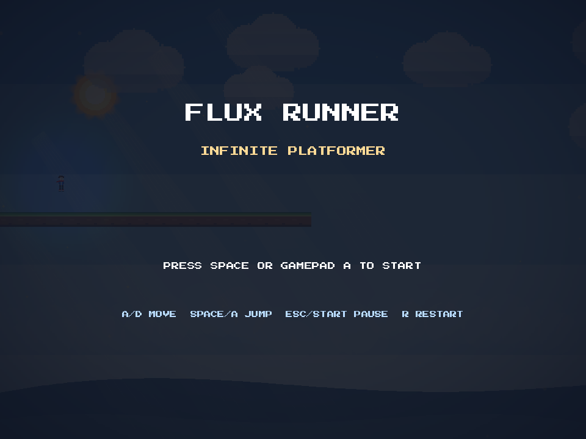
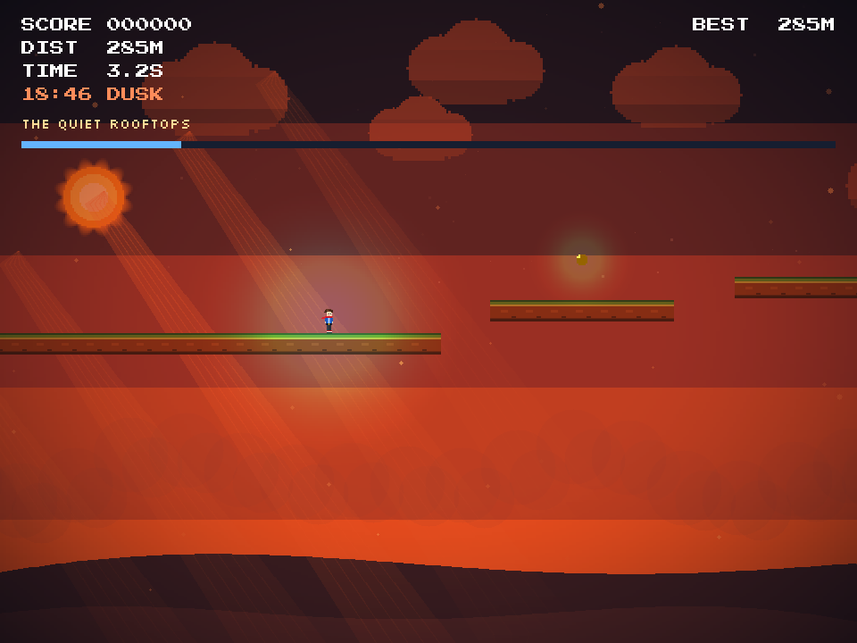
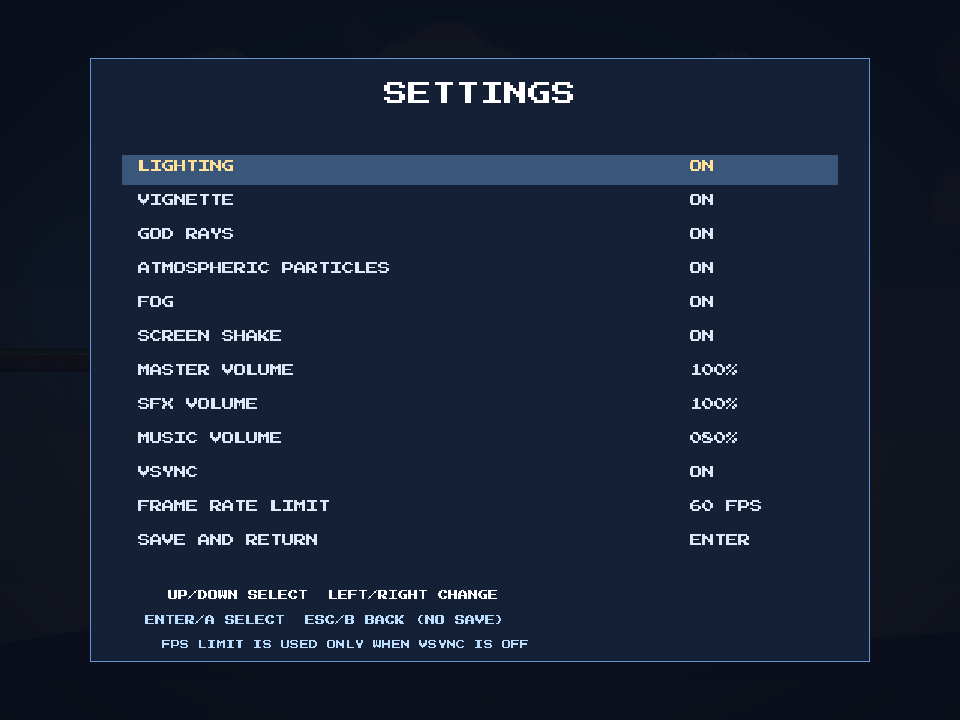
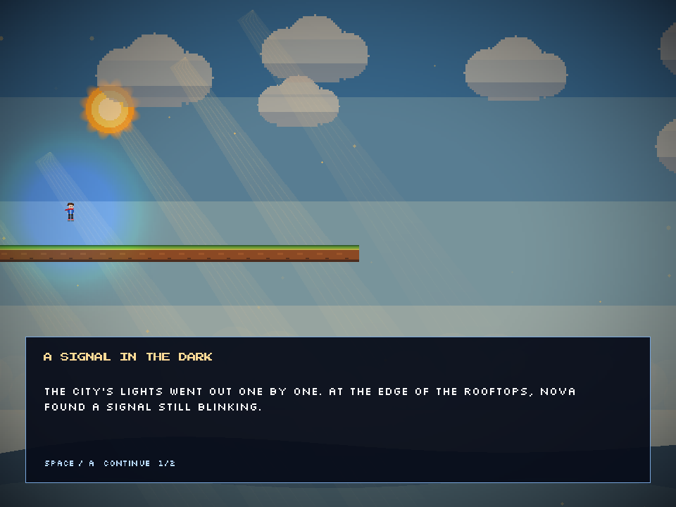

# FluxEngine

[](https://github.com/sythora/FluxEngine/actions/workflows/build.yml)
[](https://dotnet.microsoft.com/)
[](https://www.libsdl.org/)
[](#tests)

A small 2D game engine in C# on top of SDL2, plus **FluxRunner**: a pixel-art
story platformer that exercises the whole thing. PNG textures, alpha blending,
bitmap fonts, physics, particles, parallax, audio, and a scene editor are all
built in.



<p align="center">
  
</p>

<p align="center">
  
</p>

<p align="center">
  
</p>

## Highlights

- **PNG, JPEG, and BMP textures** with alpha, decoded by the engine. No
  SDL_image needed.
- **Two bundled pixel fonts** under the SIL Open Font License: Press Start 2P
  (fixed width) and Silkscreen (variable width). Both are embedded in
  `FluxEngine.dll` and used for titles, HUD, and wrapped dialogue.
- **BMFont text maps**: load your own `.fnt` + atlas with `BmFont.Load`.
- **Runtime PNG writing** through `PngWriter`, so screenshots and generated
  art need no native image library.
- **JSON scene files** and a standalone WinForms scene editor.
- **Fixed-timestep loop** with variable rendering, AABB and circle collision,
  moving and one-way platforms, camera follow/shake, particles, tweens, object
  pools, timers, and state machines.
- **WAV audio** with overlapping voices, sample caching, resampling, and
  separate SFX/music volume buses; gamepad input uses SDL's game-controller
  API.
- **Saved runtime settings** for visual effects, audio buses, VSync, and the
  frame-rate limit.

## Quick start

Requires the .NET 10 SDK. On Windows x64, the engine copies its bundled SDL2
runtime beside the executable automatically. On macOS/Linux, provide the
platform's SDL2 shared library through the usual system library path.

```text
dotnet build FluxEngine.slnx
dotnet run --project demos/FluxEngine.Demo
```

Build output lands in `build/<project>/<Configuration>/<tfm>/`, for example
`build/FluxEngine.Demo/Debug/net10.0/`.

See [GettingStarted.md](docs/GettingStarted.md) for a first scene and
[FAQ.md](docs/FAQ.md) if the window will not open.

## Browser WebAssembly host

The browser edition runs FluxRunner: Afterlight from the existing C# engine
assembly under .NET WebAssembly; gameplay is not reimplemented in JavaScript.
It includes the three-chapter story, platforming physics, signals, checkpoints,
settings, synthesized browser audio, local progress saves, and touch controls.
The Canvas backend draws engine-recorded geometry and text. SDL-backed texture
loading, native audio, lighting, and framebuffer screenshots remain native-only.

Install the .NET 10 SDK and the WebAssembly build tools, then run the host:

```text
dotnet workload install wasm-tools
dotnet run --project web/FluxEngine.Web
```

For an optimized AOT publish, run
`dotnet publish web/FluxEngine.Web -c Release`. See
[WebAssembly.md](docs/WebAssembly.md) for the architecture, current limits, and
porting notes.

## Controls

| Action | Keyboard | Gamepad |
| --- | --- | --- |
| Move | A / D or Left / Right | Left stick / D-pad |
| Jump / double jump | Space / Up | A |
| Pause / resume | Escape | Start |
| Respawn at last checkpoint | R or Space | A |
| Debug overlay | F3 | - |
| Toggle lighting, vignette, god rays, particles, fog, shake | L, 1-5 | - |
| Open settings | O | Y |
| Advance story dialogue | Space / Up | A |
| Save demo settings | F5 | - |

The demo loads and saves its visual-effect settings in `settings.json` in the
working directory. See [Settings.md](docs/Settings.md) for all settings,
defaults, and the engine API.

## PNG textures

```csharp
var texture = engine.Renderer.LoadTexture("art/player.png");
var sprite = new SpriteRenderer { Sprite = new Sprite(texture) };
```

Load through the asset cache to avoid duplicate reads:

```csharp
var texture = engine.Assets.LoadTexture(engine.Renderer, "art/player.png");
```

You can also create a texture from raw RGBA pixels, decode bytes in memory, or
grab the framebuffer as a PNG screenshot:

```csharp
var texture = engine.Renderer.LoadTextureFromMemory(pngBytes, "player.png");
var texture = engine.Renderer.CreateTextureFromPixels(rgba, width, height);
engine.Renderer.SaveScreenshot("screenshot.png");
```

Generated PNGs are validated in the regression suite with a writer/decoder
round trip, including alpha.

## Text and built-in fonts


```csharp
using FluxEngine.Content;

var font = BuiltInFonts.Load(engine.Renderer, BuiltInFont.PressStart2P);

renderer.Camera = null; // screen-space HUD
font.Draw(renderer, "SCORE 000120", new Vector2(24, 20), Color.White, 2f);
```

Load a BMFont text map for your own art:

```csharp
var font = BmFont.Load(engine.Renderer, "art/fonts/MyFont.fnt");
var size = font.Measure("HELLO\nWORLD", 2f);
```

Both bundled fonts cover printable ASCII and are safe to ship in games. See
[Fonts.md](docs/Fonts.md) for the map format, atlas workflow, and licensing,
and [THIRD_PARTY_NOTICES.md](THIRD_PARTY_NOTICES.md) for notices.

## Project layout

```text
FluxEngine.slnx            Solution: engine, editor, demo, tests
Directory.Build.props      Shared build settings and output paths
src/                       Engine source
  FluxEngine.Core/         Loop, scenes, entities, timers, pools, state machines
  FluxEngine.Graphics/     Renderer, textures, PNG writer, bitmap fonts, camera
  FluxEngine.Mathematics/  Vectors, rectangles, colors, RNG, helpers
  FluxEngine.Physics/      AABB/circle collision and rigidbodies
  FluxEngine.Audio/        WAV loading and mixing
  FluxEngine.Input/        Keyboard, mouse, named actions, gamepads
  FluxEngine.Platform/     SDL window, renderer, event loop
    runtimes/win-x64/      Bundled SDL2 runtime for Windows x64
  FluxEngine.Content/      Asset cache, BMFont parser, built-in fonts
  FluxEngine.Content/Fonts/ Embedded atlases, maps, and OFL texts
editor/                    Standalone WinForms scene editor
demos/FluxEngine.Demo/     FluxRunner story platformer demo
tests/                     Regression and gamepad test projects
docs/                      Guides and screenshots
assets/                    Original WAV samples used by FluxRunner
build/                     All build output (git-ignored)
```

## Tests

The regression project is a dependency-free console test runner:

```text
dotnet run --project tests/FluxEngine.RegressionTests/FluxEngine.RegressionTests.csproj
```

It covers scene save/reopen consistency, editor/runtime format compatibility,
collision queries, deferred component lifecycle, timers, level text parsing,
game-manager behavior, PNG round trips, and built-in font maps. Test output
goes to `build/test/<project>/`.

The solution also includes `tests/FluxEngine.GamepadTest`, an interactive
controller check. See [tests/README.md](tests/README.md).

## CI

GitHub Actions runs on Windows for every push to `main` and every pull
request: restore, build the whole solution in Release, run the regression
tests, and upload `build/` as a workflow artifact. The badge at the top links
to the latest run.

## Demo assets and screenshots

FluxRunner generates its textures as PNG files in
`demos/FluxEngine.Demo/assets/` on startup, so it has no external art
dependencies. Screenshots in `docs/images/` come from the demo itself:

```text
dotnet run --project demos/FluxEngine.Demo -- --screenshot shot.png --frame 150
dotnet run --project demos/FluxEngine.Demo -- --screenshot menu.png --frame 20 --menu
dotnet run --project demos/FluxEngine.Demo -- --screenshot settings.png --frame 1 --settings
dotnet run --project demos/FluxEngine.Demo -- --screenshot story.png --frame 1 --story
```

Original WAV samples (`jump.wav`, `land.wav`, `coin.wav`, `die.wav`, and
`music.wav`) are included in the root `assets/` folder and picked up by the
demo automatically. Replace them with your own WAVs to customize the sound.

FluxRunner now has three story chapters, checkpoint respawns, an opening
prologue, chapter dialogue, and an ending. See [Story.md](docs/Story.md) for
the story text and how to add more dialogue.

## Documentation

- [Getting Started](docs/GettingStarted.md)
- [Graphics](docs/Graphics.md)
- [Fonts](docs/Fonts.md)
- [Content](docs/Content.md)
- [Physics](docs/Physics.md)
- [Input](docs/Input.md)
- [Audio](docs/Audio.md)
- [Settings](docs/Settings.md)
- [Story and Dialogue](docs/Story.md)
- [Project Structure](docs/PROJECT_STRUCTURE.md)
- [Roadmap](ROADMAP.md)

## Third-party licenses

FluxEngine bundles Press Start 2P and Silkscreen (SIL OFL 1.1) and uses
StbImageSharp (Unlicense) for image decoding. Details and full license
locations are in [THIRD_PARTY_NOTICES.md](THIRD_PARTY_NOTICES.md).
