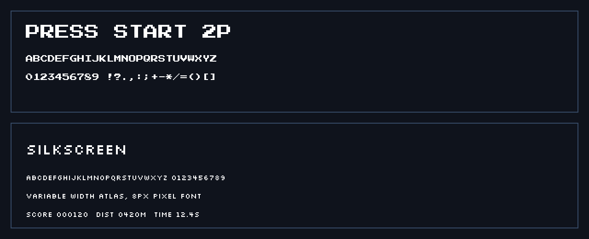

# Fonts

FluxEngine draws text with bitmap fonts. A font is a texture atlas plus a
character map that says where each glyph lives in that atlas and how wide it
is. The engine ships two open-licensed fonts inside `FluxEngine.dll`, and can
load your own BMFont `.fnt` maps.

## Built-in fonts

Both fonts cover printable ASCII (space through `~`) and are embedded in the
engine assembly, so there are no files to copy into your game.

| Font | Style | License |
| --- | --- | --- |
| Press Start 2P | Fixed width, 8px, chunky arcade look | SIL OFL 1.1 |
| Silkscreen | Variable width, 8px, compact pixel look | SIL OFL 1.1 |



```csharp
using FluxEngine.Content;
using FluxEngine.Graphics;

var title = BuiltInFonts.Load(engine.Renderer, BuiltInFont.PressStart2P);
var small = BuiltInFonts.Load(engine.Renderer, BuiltInFont.Silkscreen);

title.Draw(engine.Renderer, "FLUX RUNNER", new Vector2(40, 40), Color.White, scale: 4f);
small.Draw(engine.Renderer, "PRESS SPACE TO START", new Vector2(40, 100), Color.White, scale: 2f);
```

Scale is a world/screen-unit multiplier applied to the atlas pixels. For
crisp pixel art, keep it on whole numbers. The SDL renderer uses nearest
sampling, so non-integer scales can still look slightly uneven.

Text is drawn at the top-left of the first line. Draw HUD text after setting
`renderer.Camera = null` so it stays in screen space:

```csharp
renderer.Camera = null;
font.Draw(renderer, $"SCORE {score:D6}", new Vector2(24, 20), Color.White, 2f);
```

Measure before centering:

```csharp
var text = "GAME OVER";
var width = font.MeasureWidth(text, 4f);
font.Draw(renderer, text, new Vector2((960 - width) / 2, 200), Color.White, 4f);
```

`Measure` returns both width and height and handles `\n`:

```csharp
var size = font.Measure("LINE ONE\nLINE TWO", 2f);
```

## Loading a BMFont map

`BmFont.Load` reads a text-format `.fnt` map, resolves the page texture
relative to the map, and returns a `BitmapFont`:

```csharp
using FluxEngine.Content;

var font = BmFont.Load(engine.Renderer, "art/fonts/MyFont.fnt");
```

The map may look like this:

```text
info face="My Font" size=8
common lineHeight=8 base=8
page id=0 file="MyFont.png"
char id=65 x=64 y=8 width=8 height=8 xoffset=0 yoffset=0 xadvance=8
kernings count=0
```

Supported tags are `info`, `common`, `page`, and `char`. `kernings` is
accepted but ignored. Only the first page is used, so export a single-page
atlas. Tools such as BMFont, Hiero, or Littera can write BMFont text, XML, or
binary output; FluxEngine reads the text `.fnt` format.

To inspect a map without creating a texture, parse it directly:

```csharp
var data = BmFont.Parse(File.ReadAllText("art/fonts/MyFont.fnt"));
Console.WriteLine($"{data.Name}: {data.Glyphs.Count} glyphs, {data.LineHeight}px tall");
```

`BuiltInFonts.ReadFontMap` exposes the raw map for the bundled fonts, which is
also useful in tests.

## Making an atlas

1. Export your font as 8-bit or 32-bit grayscale/RGBA glyphs with transparent
   background, one page, text-format `.fnt`, padding of at least 1px.
2. Keep `xadvance` values from the export. FluxEngine uses them for both
   drawing and measuring.
3. Save the `.fnt` and its `.png` page in the same folder.
4. Load with `BmFont.Load`.

Glyphs are blended with the font texture's alpha, so a white atlas can be
tinted any color at draw time through the `color` argument.

## Custom fonts without an atlas

`PixelFont` in `FluxEngine.Core` still exists for tiny debug text. It draws
5x6 rectangle glyphs and needs no texture. For game UI, prefer `BitmapFont`
because it handles kerning-free proportional maps and scales cleanly.

## Licensing

The built-in fonts are licensed under the SIL Open Font License 1.1, which
permits bundling and redistribution in commercial and non-commercial games.
Attribution is not required, but the license text must travel with the font.
See `THIRD_PARTY_NOTICES.md` and the `*-OFL.txt` files in
`src/FluxEngine.Content/Fonts/`.

When shipping your own font, check its license before embedding it. OFL fonts
are a safe default; rasterized atlases are derivatives and keep the same
license.
